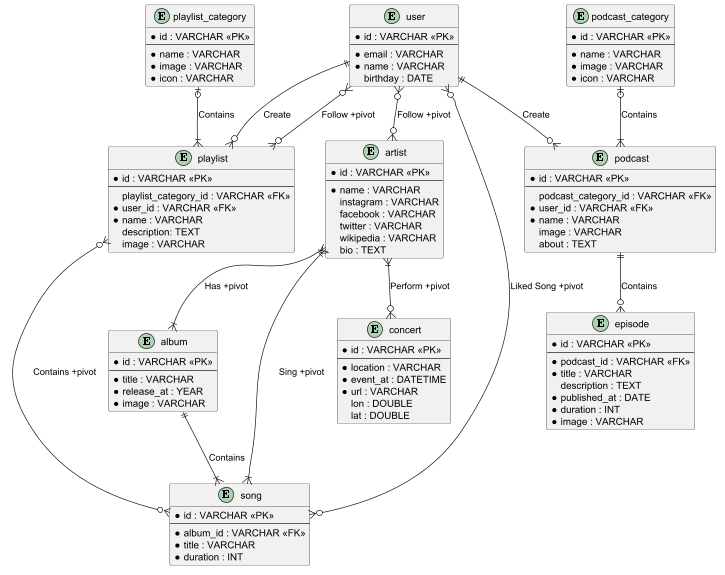

# Spotify Database Design Clone

## Overview

A relational database design project inspired by Spotify, built using MySQL. This project focuses on modeling music streaming platform data, including users, artists, albums, songs, playlists, podcasts, episodes, and concerts.

This project is also part of my learning journey toward Database Administrator (DBA) roles, covering database design, SQL implementation, data integrity, performance optimization, and database administration.

## Objectives

- Design a relational database schema.
- Implement entities and relationships using MySQL.
- Apply primary keys, foreign keys, and constraints.
- Implement one-to-many and many-to-many relationships.
- Practice SQL queries and data management.
- Learn database performance optimization and administration.

## Database Scope

### Core Tables (10)

- user
- artist
- album
- song
- playlist_category
- playlist
- podcast_category
- podcast
- episode
- concert

### Pivot Tables (9)

- artist_album
- artist_song
- playlist_song
- user_artist_follow
- user_song_like
- user_playlist_follow
- artist_concert

> Note: The pivot table list above is currently a placeholder to be updated with the complete implemented list.

## Entity Relationship Diagram



## Technologies

- MySQL
- SQL
- PlantUML
- DataGrip
- WebStorm

## Project Progress

- [x] Requirements and database scope
- [x] Entity identification
- [x] ERD design
- [x] Core table implementation
- [x] Pivot table implementation
- [ ] Dummy data population
- [ ] Data integrity validation
- [ ] SQL query practice
- [ ] Indexing and query optimization
- [ ] Backup and recovery
- [ ] Database user privileges
- [ ] Monitoring
- [ ] Docker deployment

## Project Structure

```text
spotify-database-design/
├── README.md
├── docs/
│   └── erd.png
└── sql/
    ├── 01_create_database.sql
    ├── 02_create_core_tables.sql
    └── 03_create_pivot_tables.sql
```

## Learning Goals

This project is being developed as a practical portfolio to demonstrate relational database design and foundational MySQL database administration skills.

More features and administration practices will be added as the project progresses.
