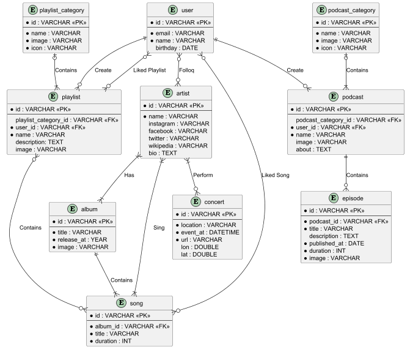

# Spotify Playlist Management Database


A relational database design project inspired by Spotify, built with MySQL.

## Overview

This project focuses on designing and implementing a relational database for playlist management and related music platform features.

The database models users, artists, albums, songs, playlists, podcasts, episodes, concerts, and user interactions. It is developed as a practical learning project toward Database Administrator (DBA) and database-related roles.

The project covers relational database design, schema implementation, data population, data integrity validation, and SQL query practice.

## Objectives

- Design a relational database schema and Entity Relationship Diagram (ERD).
- Implement entities and relationships using MySQL.
- Apply primary keys, foreign keys, and composite primary keys.
- Implement one-to-many and many-to-many relationships.
- Populate tables with sample datasets.
- Validate data integrity and consistency.
- Practice SQL queries for data retrieval, joins, aggregation, and analysis.

## Technology Stack

- MySQL
- SQL
- PlantUML
- DataGrip

## Database Scope

### Core Tables (10)

| Table | Description |
|---|---|
| `user` | Stores user information |
| `artist` | Stores artist information |
| `album` | Stores album metadata |
| `song` | Stores song information |
| `playlist_category` | Categorizes playlists |
| `playlist` | Stores user-created playlists |
| `podcast_category` | Categorizes podcasts |
| `podcast` | Stores podcast information |
| `episode` | Stores podcast episodes |
| `concert` | Stores concert event information |

### Pivot Tables (7)

| Table | Relationship |
|---|---|
| `artist_album` | Artist ↔ Album |
| `artist_song` | Artist ↔ Song |
| `playlist_song` | Playlist ↔ Song |
| `user_artist_follow` | User ↔ Artist |
| `user_song_like` | User ↔ Song |
| `user_playlist_like` | User ↔ Playlist |
| `artist_concert` | Artist ↔ Concert |

**Total: 17 tables (10 core tables + 7 pivot tables).**

## Key Relationships

### One-to-Many Relationships

- Album → Song
- Podcast → Episode
- User → Playlist
- User → Podcast
- Playlist Category → Playlist
- Podcast Category → Podcast

### Many-to-Many Relationships

Many-to-many relationships are implemented using pivot tables:

- Artist ↔ Album (`artist_album`)
- Artist ↔ Song (`artist_song`)
- Playlist ↔ Song (`playlist_song`)
- User ↔ Artist (`user_artist_follow`)
- User ↔ Song (`user_song_like`)
- User ↔ Playlist (`user_playlist_like`)
- Artist ↔ Concert (`artist_concert`)

## Entity Relationship Diagram



## Project Workflow

1. Requirements Analysis
2. Entity Identification
3. Database Design & ERD
4. Schema Implementation
5. Dummy Data Population
6. Data Integration Validation
7. SQL Query Practice
8. Database Administration & Optimization

## Project Progress

- [x] Requirements and database scope
- [x] Entity identification
- [x] ERD design
- [x] Core table implementation
- [x] Pivot table implementation
- [x] Dummy data population
- [x] Data integration validation
- [ ] SQL query practice
- [ ] Indexing and query optimization
- [ ] Backup and recovery
- [ ] Database user privileges
- [ ] Monitoring
- [ ] Docker deployment

## Repository Structure

```text
spotify-playlist-management-database/
├── docs/
│   ├── erd.png
│   └── erd.puml
├── sql/
│   ├── 01_core_tables.sql
│   ├── 02_pivot_tables.sql
│   ├── 03_input_dummy_data.sql
│   └── 04_data_integrity_validation.sql
├── README.md
└── spotify_logo.png
```

## Learning Goals

This project is being developed as a practical portfolio to demonstrate relational database design, MySQL implementation, SQL querying, data integrity validation, and foundational database administration skills.

Additional database administration practices will be implemented as the project progresses.

## Disclaimer

This project is for educational purposes and is inspired by Spotify. It is not affiliated with, endorsed by, or connected to Spotify.

